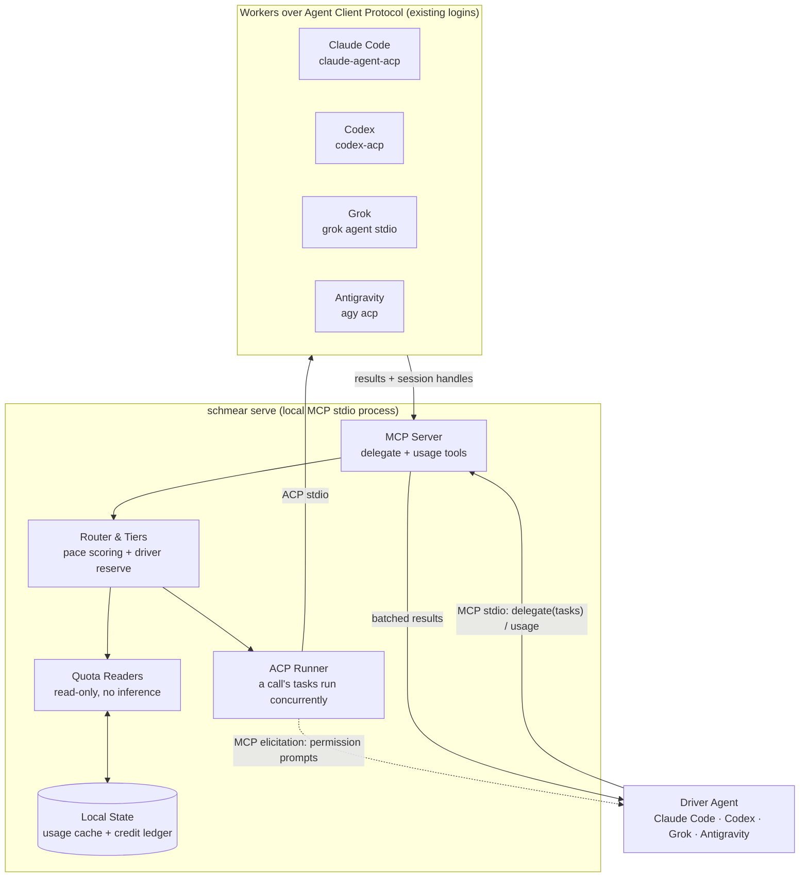
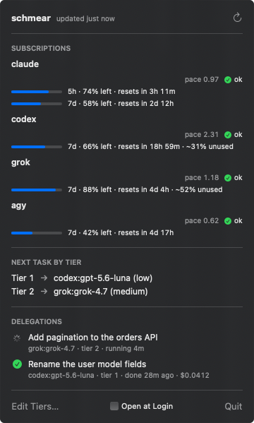

<p align="center">
  
</p>

<h1 align="center">schmear</h1>

<p align="center"><b>Optimize your weekly AI budgets by delegating to subagents across your subscriptions intelligently.</b></p>

<p align="center">
  <a href="https://github.com/kevin1chun/schmear/actions/workflows/ci.yml"></a>
  <a href="https://www.npmjs.com/package/schmear"></a>
  <a href="LICENSE"></a>
  <a href="https://buymeacoffee.com/kevin1chun"></a>
</p>
I run 4 AI subs across 3 providers, and don't have unlimited corporate token budget for my personal projects. Claude Code is my primary driver, but it's annoying and slow when I'm running low on usage and need to swap accounts or providers because of the whole oauth + prompt cache miss dance. The worst is when I end a week with unspent usage on the table (wasted money!). You probably also don't use those monthly API credits that are included with your Pro/Ultra subs.

<br />

Schmear solves this by transparently and intelligently spreading load across all of your subscriptions via ACP. At its core, Schmear is a load balancing algorithm that allows you to get the most out of your tokens without any of the toil.
## Install

### CLI

On macOS (including Intel Macs) or Linux with Node 22.18 or later:

```sh
npm i -g schmear && schmear init
```

Or with Homebrew, `brew install kevin1chun/tap/schmear`, then `schmear init`. The menu bar and tray apps below are optional.

### macOS app

Requires macOS 14+ (Sonoma) on Apple silicon. Install with Homebrew, which also installs the CLI and Node:

```sh
brew install --cask kevin1chun/tap/schmear
```

Or download the notarized `Schmear.zip` from [GitHub Releases](https://github.com/kevin1chun/schmear/releases); without the CLI, its **Set Up in Terminal** button installs it.

### Linux tray app

Release archives for x86_64 and ARM64 run against your system's Qt and need glibc 2.34+ and Qt 6.4+: Ubuntu 24.04, Debian 12 and 13, Fedora and Arch qualify. Older systems with Qt 6.4+ can [build from source](linux/README.md#build-from-source). The CLI comes from npm and needs Node 22.18 or later:

```sh
npm i -g schmear
```

Install the Qt runtime and curl for your distribution:

```sh
sudo apt install curl libqt6widgets6t64 libqt6network6t64 qt6-qpa-plugins qt6-wayland  # Ubuntu 24.04
sudo apt install curl libqt6widgets6 libqt6network6 qt6-qpa-plugins qt6-wayland        # Debian 12 and 13
sudo dnf install curl qt6-qtbase-gui qt6-qtwayland                                     # Fedora
sudo pacman -S --needed curl qt6-base qt6-wayland                                       # Arch
```

Then download, verify and install, in `sh` or `bash`:

```sh
(
set -eu
arch=$(uname -m)
case "$arch" in x86_64|aarch64) ;; *) echo "Unsupported architecture: $arch" >&2; exit 1 ;; esac
f=schmear-tray-linux-$arch.tar.gz
work=$(mktemp -d)
trap 'rm -rf "$work"' EXIT
cd "$work"
url=https://github.com/kevin1chun/schmear/releases/latest/download
curl -fsSLO "$url/$f"
curl -fsSLO "$url/$f.sha256"
sha256sum -c "$f.sha256"
tar -xzf "$f"
sh "./${f%.tar.gz}/install.sh"
)
```

`schmear init` runs the same steps for you when you accept its offer (the block is `scripts/install-tray.sh`). The installer puts `schmear-tray` in `~/.local/bin` and adds a "schmear" entry to the app menu. Its tray icon needs KDE Plasma, XFCE, GNOME with the AppIndicator extension (built into Ubuntu; on Fedora and Debian install and enable `gnome-shell-extension-appindicator`), or waybar's `tray` module on Sway and Hyprland, where Open at Login also needs uwsm or dex to run XDG autostart entries. Without a tray it runs as a normal window.

To upgrade, quit schmear from its tray menu, rerun the block and start it again. To uninstall:

```sh
rm -f ~/.local/bin/schmear-tray ~/.local/share/applications/schmear-tray.desktop \
  ~/.local/share/icons/hicolor/scalable/apps/schmear-tray.svg ~/.config/autostart/schmear-tray.desktop
```

### First run

```sh
schmear init
schmear credits   # optional: spend your plans' API credits
```

`schmear init` registers schmear with your agents and asks which subscriptions to use; Antigravity is unticked until you tick it, because Google's terms [may not allow it](docs/safety.md). With a Claude or Codex subscription, it also downloads the two ACP adapters (about 45 MB) with npm. It ends by offering to install the [menu bar or tray app](#menu-bar-and-tray-apps) if you have not, and opens it. Restart your agent afterwards.

`schmear credits` is only for [API credits](#api-credits); init offers it too, and a subscriptions-only setup never needs it.

Then ask your agent to delegate, for example: *"Have another agent write tests for src/parse.ts."*

### Upgrade

With Homebrew (add `brew upgrade --cask schmear` for the menu bar app):

```sh
brew upgrade schmear && schmear init --yes
```

With npm:

```sh
npm i -g schmear && schmear init --yes
```

`schmear init --yes` refreshes each agent's registration and skill. Restart your agents afterwards. The first Claude or Codex task after an upgrade may take a few seconds while schmear installs that release's adapters. For the Linux tray app, see above.

### Uninstall

`schmear uninstall` removes schmear from every agent and deletes its skills, config and state; then `brew uninstall --cask schmear && brew uninstall schmear` if you installed with Homebrew.

## How it works

1. Your agent calls schmear's `delegate` tool with one or more self-contained tasks, each with a minimum model tier.
2. schmear reads every subscription's quota and reset time, without running a model.
3. Each task goes to the subscription with the most quota left for the time left until its reset, on a model at or above the task's tier.
4. The worker runs on your existing login and the result comes back to your agent. One call carries up to 50 tasks (`schmear max-tasks <n>` or the app's tier editor), and at most 10 run at once on one usage pool (`schmear max-per-pool <n>`).



### The algorithm

Every subscription gets a **pace**: how fast it would need to spend to use up its quota by its next reset. The ordering is [least-laxity-first](https://en.wikipedia.org/wiki/Least_slack_time_scheduling) scheduling from real-time systems, with unused quota as the remaining work and the reset as the deadline, taken as a ratio so windows of different lengths compare.

```
pace = (fraction left − threshold) × window length ÷ time until reset
```

A pace above 1 means quota will expire unused at the current rate, so the highest pace goes first. For example, with a weekly Grok plan 100% unused and resetting in 6.5 days, and the Claude plan you're typing in 40% unused and resetting in 3 days:

| | Left | Threshold | Resets in | Pace |
|---|---|---|---|---|
| Grok | 100% | 2% floor | 6.5 d | 0.98 × 7 ÷ 6.5 = **1.06** |
| Claude (your driver) | 40% | 5% reserve | 3 d | 0.35 × 7 ÷ 3 = 0.82 |

The next task goes to Grok. The rules around the pace:

- **Floor.** A subscription with 2% or less left in any window, or one whose usage can't be read, gets no tasks.
- **Reserve.** The subscription of the agent you're typing in keeps 5% for you, until the last 2 hours before its reset.
- **Tier.** Only models at or above the task's tier are candidates.
- **Ties.** Subscriptions within 5% of the best pace count as tied. Tasks in one call spread across them, and among them schmear prefers the least-loaded one, then the lowest tier that fits.
- **Reroute.** A worker that runs out of quota mid-task is retried on the next best subscription. If none is left, the result is `no_quota`.
- **Prompt-cache-aware routing.** A continued task stays on the subscription and model that ran it, whatever the pace says, so the provider's prompt cache still covers its context. Only new tasks are routed by pace.

Usage readings are cached for up to 5 minutes. The full rules are in the [guide](docs/guide.md#routing).

### Default tiers

A task's tier is the weakest model class it may run on. Each tier is anchored to a Claude model at `medium` effort. Another provider's model qualifies when it scores at least that model on the [Artificial Analysis Intelligence Index](https://artificialanalysis.ai/) (v5.0.1) and, where [Epoch AI's Capabilities Index](https://epoch.ai/data/eci_scores.csv) rates it, is not significantly below it there (both read 2026-11-24). Each pool gets the weakest model and effort that clears the bar, by one rule with no per-provider exceptions.

| Tier | Claude | Codex | Grok | Antigravity: Gemini | Antigravity: Argon | Antigravity: Claude |
|---|---|---|---|---|---|---|
| 1 | Haiku | GPT-6 Luna @max | Grok 4.7 | Gemini 4 Hydrogen | Gemini 4 Argon | Sonnet 5.5 |
| 2 | Sonnet | GPT-6.1 Terra | — | Gemini 4 Hydrogen | Gemini 4 Argon | Sonnet 5.5 |
| 3 | Opus | GPT-6.1 Terra @max | — | Gemini 4 Hydrogen @high | Gemini 4 Argon | Opus 5.5 |
| 4 | Fable | GPT-6.2 Sol @xhigh | — | Gemini 4 Carbon | — | — |

Entries without an effort run at `medium`. Some entries clear their bar narrowly: GPT-6.2 Sol `xhigh` ties Fable `medium` and Epoch doesn't rate it yet, and Argon ties Opus. Scores and the reasoning behind each entry are in [docs/research/model-tiers.md](docs/research/model-tiers.md#3-tier-list). To change the list, or the reserve your driver keeps, see [Tier configuration](docs/guide.md#tier-configuration).

### Multiple accounts

Two Claude subscriptions under different emails, or two logins of any supported CLI, can both take work. Every subscription has a nickname: the login each CLI already has is `@default` (`claude@default`), and each one you add gets a name you pick, such as `claude@work`.

After the subscription checklist, `schmear init` asks "Add another subscription?": pick the provider and a nickname, sign in to the account you're linking in your browser (at claude.ai, chatgpt.com, grok.com or your Google account), confirm, and the CLI's usual sign-in opens and approves that account. It asks again until you pick Done.

`schmear usage` then shows `claude@work` as its own pools next to `claude@default`, and the router weighs it by pace like any other subscription. schmear doesn't switch your login: it sets `CLAUDE_CONFIG_DIR` only on the worker processes it starts for that account, so the agent you're typing in stays on its own login. Codex, Grok and Antigravity work the same way; see [Accounts](docs/guide.md#accounts).

### API credits

Claude Max includes $100 or $200 a month in API credits, and Google AI Pro and Ultra include $10 to $100 a month in Google Cloud credits. Both expire unused unless something spends them. `schmear credits` turns each into a credit pool of the account that owns it (`claude-credits@work` belongs to `claude@work`): it gets your Claude Console or Google session, by importing it from your browser if you choose or from a pasted Cookie header, then takes the org's API key at a hidden prompt and stores it in your login Keychain or keyring. schmear reads the balance with that session, spends it on that key through the same workers, and stops at 2% of the grant. Each pool has its own ledger and runs under its owner account's login. `schmear credits status` shows what each pool can spend and why not. Google credits are spent through Antigravity, which has no per-run spend limit; see [Credit pools](docs/guide.md#credit-pools) and [Safety](docs/safety.md) before setting one up.

## Menu bar and tray apps

The macOS menu bar app and the Linux tray app show your pools (each API credit pool's dollars left, expiry and org under its account), pace, next lane per tier and recent delegations, and edit your tiers. They notify you once when API credit is about to expire or a credit session has expired. When an agent loses its connection to schmear, as after a Homebrew upgrade, the icon shows a warning and **Reconnect** fixes it. `schmear init` offers to install the app and opens it. Both read the `schmear` CLI; see [macos/README.md](macos/README.md) and [linux/README.md](linux/README.md). Inspired by [CodexBar](https://github.com/steipete/CodexBar).



## Supported agents

| Agent | CLI | Delegates tasks | Runs tasks |
|---|---|:---:|:---:|
| Claude Code | `claude` | ✓ | ✓ |
| Codex | `codex` | ✓ | ✓ |
| Grok | `grok` | ✓ | ✓ |
| Antigravity | `agy` | ✓ | ✓ |

Workers launch over the [Agent Client Protocol](https://agentclientprotocol.com) on the logins you already have. No API keys required.

## Docs

[Guide](docs/guide.md) · [Safety](docs/safety.md) · [Design](docs/spec.md) · [Changelog](CHANGELOG.md) · [Contributing](CONTRIBUTING.md)

## Support

If you love this and get more money out of your subs, please consider helping me out!

<a href="https://buymeacoffee.com/kevin1chun"></a>

## License

[MIT](LICENSE).
